# Awesome Data Privacy & GDPR Compliance 🛡️

<p align="center">
  
</p>

<p align="center">
  <a href="https://github.com/ishandutta2007/Awesome-Awesome-Awesome"></a>
  <a href="https://discord.gg/jc4xtF58Ve"></a>
  <a href="https://github.com/ishandutta2007/Awesome-Data-Privacy-GDPR-Compliance/stargazers"></a>
  <a href="https://github.com/ishandutta2007/Awesome-Data-Privacy-GDPR-Compliance/network/members"></a>
  <a href="https://github.com/ishandutta2007/Awesome-Data-Privacy-GDPR-Compliance/blob/main/LICENSE"></a>
  <a href="https://github.com/ishandutta2007"></a>
</p>

---

## 🧭 Curated Data Privacy, GDPR & Regulatory Compliance Ecosystem

> 🎯 **A comprehensive, SEO-optimized directory of top SaaS platforms and open-source software for GDPR, CCPA/CPRA, LGPD, and AI Governance compliance.**  
> *Focused on Consent Management Platforms (CMP), Data Subject Access Request (DSAR) Automation, Data Loss Prevention (DLP), Sensitive Data Discovery (PII/PHI), and Privacy-by-Design Governance.*  
> **Last updated: March 2026** ⚡

---

## 📑 Table of Contents
- [📊 Sector Overview & Market Dynamics](#-sector-overview--market-dynamics)
- [☁️ SaaS & Hosted Enterprise Platforms](#-saashosted-enterprise-platforms)
- [🔓 Open-Source GitHub Projects](#-open-source-github-projects)
- [🤝 How to Contribute](#-how-to-contribute)
- [⭐ Star History](#-star-history)
- [💖 Support & Sponsorship](#-support--sponsorship)
- [⚖️ Disclaimer](#️-disclaimer)

---

## 📊 Sector Overview & Market Dynamics

The global **Data Privacy Management Software Market** is estimated at **$6.2B–$7.6B in 2026** and projected to surge past **$47B–$70B by 2033–2034**, expanding at a hyper-growth compound annual growth rate (**CAGR of ~26% to 39%**). 

The sector is **moderately fragmented yet increasingly bifurcated into two distinct layers**:
1. **Consolidated Enterprise Tier (High concentration)**: Heavyweights like OneTrust, Securiti.ai (Veeam), and BigID command the multi-cloud enterprise category with modular suites addressing holistic GRC, Data Security Posture Management (DSPM), and EU AI Act readiness.
2. **Specialized Point-Solution & Developer Ecosystem (High fragmentation)**: Agile competitors (e.g., Osano, Ketch, Transcend) alongside self-hosted open-source libraries (e.g., Presidio, Prowler, OpenMetadata, Consent-O-Matic) thrive by capturing specialized niches like headless cookie consent, programmatic DSAR orchestration, automated PII de-identification, and CI/CD privacy scanning.

---

## ☁️ SaaS/Hosted Enterprise Platforms

| Product | Scale (Valuation / Revenue) | Description | Starting Pricing | Free Tier / Trial Limits |
|:---|:---|:---|:---|:---|
| **[OneTrust](https://www.oneTrust.com/)** 🛡️ | **$4.5B** valuation ($500M+ ARR) | Enterprise privacy management platform with modules for Privacy Management, GRC, Consent, TPRM, ESG, Ethics, AI Governance, and Certification Automation. Trial tenants are sales-provisioned rather than instant self-serve. | Starts at **$10,000/year** (entry-level / single-module baseline) | **14-day free trial** (sales/rep-assisted provisioning; full platform demo environment) |
| **[Freshworks Data Privacy Controls](https://www.freshworks.com/)** 📦 | **~$3.3B** market cap ($838M+ annual revenue) | Privacy controls and compliance features embedded within Freshworks suites (Freshdesk, Freshsales). EU hosting available; DPA included in terms; sub-processors published; on EU–US Data Privacy Framework list. | Starts at **$19/agent/month** (Freshdesk Growth tier billed annually, or $23/mo billed monthly) | **14-day free trial** (Freshdesk/Freshchat full Enterprise features, no credit card required) or **21-day free trial** (Freshsales); 6-month free tier for up to 2 agents on basic email Freshdesk |
| **[Securiti.ai](https://securiti.ai/)** 🤖 | **$1.725B** valuation (acquired by Veeam in 2025) | Unified Data Command Center for data security posture management (DSPM), privacy rights automation, governance, and AI safety. Enterprise volume and connector based. | Starts at **$14,000/year** (base unit cost on enterprise cloud marketplace listings) | **No self-serve free tier**; custom Sales Proof-of-Concept (PoC) & guided sandbox evaluation provided upon request |
| **[BigID](https://bigid.com/)** 🔍 | **$1.0B+** valuation ($100M+ ARR) | Data intelligence and DSPM platform for discovery, classification, and privacy compliance across 100+ multi-cloud and on-premises data sources. | Starts at **$175,000/year** (12-month commitment list price for BigID Next Discovery Foundation on AWS Marketplace; full 3-year C4 Foundation package runs $525,000) | **No self-serve free tier**; enterprise sales-led Proof of Concept (PoC) evaluation available upon sales demo approval |
| **[TrustArc](https://www.trustarc.com/)** 🌐 | **~$300M–$400M** est. valuation ($59M–$82M ARR; $107M raised) | Modular privacy platform covering Cookie Consent Manager, Data Inventory Hub, PIA Manager, and Privacy Rights Automation. Entry single-module contracts scale up to mid-market multi-module deployments. | Starts at **$8,000–$10,000/year** (entry single-module baseline; implementation fees quoted separately) | **No self-serve free tier**; guided sales demonstration and custom proof-of-concept evaluation environments upon request |
| **[Transcend](https://transcend.io/)** ⚡ | **~$200M–$300M** est. valuation ($90M total funding raised) | Privacy infrastructure platform providing automated data subject request (DSAR) fulfillment, consent management, telemetry, and AI governance controls. | Starts at **$10,000/year** (entry-level plan baseline) | **No self-serve free tier**; personalized demo and custom sales-provisioned sandbox evaluation |
| **[DataGrail](https://www.datagrail.io/)** 🔄 | **~$250M** est. valuation ($15M–$18M ARR; $84.2M raised) | Privacy automation platform with 2,000+ pre-built integrations for DSAR fulfillment, automated data mapping, and consent management. | Starts at **$30,000/year** (small deployment tier; implementation quoted separately) | **No self-serve free tier**; custom live demonstration and guided proof of concept via sales |
| **[Osano](https://www.osano.com/)** 🍪 | **~$100M–$250M** est. valuation ($25M ARR; $44.4M raised) | Data privacy management platform specializing in cookie consent management, data subject rights (DSAR), and vendor risk tracking. | Starts at **$199/month** (Plus plan, up to 30,000 visitors/month and 3 domains; billed annually/monthly) | **Forever-Free plan**: 1 user, 1 domain, up to 5,000 monthly visitors (basic cookie consent). Paid tiers also offer a **30-day free trial** |
| **[Mine PrivacyOps](https://www.mineprivacy.com/)** 🧠 | **~$120M** est. valuation ($42.5M raised) | Privacy operations platform (MineOS) offering automated data mapping, continuous discovery, consent management, and DSAR automation. | Starts at **$8,000/year** (paid automated tier) | **Forever-Free plan**: $0/mo for basic portal & manual request handling workspace; automated enterprise features offer a custom **free Proof-of-Concept (PoC)** |
| **[Ketch](https://www.ketch.com/)** 🚀 | **~$100M** est. valuation ($9M–$14.5M ARR; $43M raised) | Programmatic privacy UX and data permissioning platform with transparent self-serve tiers for consent, tracker scanning, and governance. | Starts at **$150/month** (Starter plan, up to 30,000 monthly visitors; Plus plan at $499/month for 100,000 visitors) | **Forever-Free plan**: $0/mo for consent management up to 5,000 unique visitors/month, tracker scanning, and privacy law templates |

---

## 🔓 Open-Source GitHub Projects

> Repositories are sorted by **GitHub Star Counts (Descending)**. Every project includes a live star badge linking directly to its stargazer community.

| Project | Stars | Description | Focus Area |
|:---|:---|:---|:---|
| **[OpenMetadata](https://github.com/open-metadata/OpenMetadata)** 🗄️ | [](https://github.com/open-metadata/OpenMetadata/stargazers) | Unified data governance platform offering automated sensitive data classification (PII), column-level lineage tracking, and processing metadata to power enterprise GDPR Article 30 Records of Processing Activities (ROPA). | Data Catalog & PII Lineage |
| **[Prowler](https://github.com/prowler-cloud/prowler)** ☁️ | [](https://github.com/prowler-cloud/prowler/stargazers) | Open-source security and compliance framework for AWS, Azure, GCP, and Kubernetes. Features out-of-the-box regulatory audit assessments for GDPR, HIPAA, ISO 27001, SOC 2, and CIS benchmarks. | Cloud Security & Compliance Audit |
| **[Microsoft Presidio](https://github.com/microsoft/presidio)** 🔒 | [](https://github.com/microsoft/presidio/stargazers) | Production-ready SDK by Microsoft for detecting, analyzing, and redacting Personally Identifiable Information (PII) in text, structured datasets, and images for privacy compliance and AI pipelines. | PII Anonymization & Redaction |
| **[CookieConsent](https://github.com/orestbida/cookieconsent)** 🍪 | [](https://github.com/orestbida/cookieconsent/stargazers) | Lightweight, accessible, standalone vanilla JavaScript cookie consent and preference management plugin with zero external dependencies, built specifically for strict GDPR and CCPA/CPRA compliance. | Consent Management (CMP) |
| **[Amundsen](https://github.com/amundsen-io/amundsen)** 🧭 | [](https://github.com/amundsen-io/amundsen/stargazers) | Data discovery and metadata engine created at Lyft. Indexes distributed data assets, maps dataset lineage, and tags sensitive privacy attributes across enterprise data warehouses. | Data Discovery & Inventory |
| **[CISO Assistant](https://github.com/intuitem/ciso-assistant-community)** 📋 | [](https://github.com/intuitem/ciso-assistant-community/stargazers) | Community-driven GRC platform automating compliance management, risk tracking, and audits across 200+ regulatory frameworks including GDPR, NIS2, DORA, ISO 27701, and SOC 2. | GRC & Risk Assessment |
| **[Consent-O-Matic](https://github.com/cavi-au/Consent-O-Matic)** 🤖 | [](https://github.com/cavi-au/Consent-O-Matic/stargazers) | Automated browser extension and privacy engine that automatically navigates, answers, and denies non-essential consent popups and cookie tracking banners according to user preferences. | Client-side Privacy & Anti-Tracking |
| **[Osano CookieConsent](https://github.com/osano/cookieconsent)** 📜 | [](https://github.com/osano/cookieconsent/stargazers) | Popular open-source client-side cookie consent banner utility built to fulfill European ePrivacy Directive and GDPR requirements on public web applications. | Cookie Consent |
| **[Klaro!](https://github.com/klaro-org/klaro-js)** ⚖️ | [](https://github.com/klaro-org/klaro-js/stargazers) | Open-source, compliant consent manager and privacy manager that coordinates third-party trackers, scripts, and embeds with granular user consent preferences. | Consent Management (CMP) |
| **[OpenDLP](https://github.com/ezra100/OpenDLP)** 🔎 | [](https://github.com/ezra100/OpenDLP/stargazers) | Agent-based and agentless sensitive data discovery tool designed to scan Windows/UNIX file systems, databases, and network shares for unencrypted credit cards, SSNs, and personal data. | Data Loss Prevention (DLP) |
| **[scanprivacy](https://github.com/fabriziosalmi/scanprivacy)** 🕵️ | [](https://github.com/fabriziosalmi/scanprivacy/stargazers) | External, non-invasive automated GDPR Article 13 & 14 scanner checking public attack surfaces, unencrypted credential forms, third-party data leakage, and emitting SARIF 2.1.0 for CI/CD pipelines. | CI/CD Privacy & Surface Scanner |

---

## 🤝 How to Contribute

Contributions, suggestions, and corrections are warmly welcomed! 🎉

1. **Fork the repository** to your own GitHub account.
2. **Create a feature branch**:
   ```bash
   git checkout -b feature/add-new-privacy-tool
   ```
3. **Add or update entries** in `README.md` following the established table structure:
   - Provide accurate pricing and specific free trial / free tier limits for SaaS products.
   - For open-source tools, include the proper stargazers badge format `[](https://github.com/owner/repo/stargazers)`.
4. **Commit your changes**:
   ```bash
   git commit -m "feat: add [Tool Name] to open-source compliance list"
   ```
5. **Open a Pull Request** with a brief summary of the project and why it belongs here.

---

## ⭐ Star History

[](https://www.star-history.com/#ishandutta2007/Awesome-Data-Privacy-GDPR-Compliance&type=date&legend=top-left)

---

## 💖 Support & Sponsorship

If you found this resource helpful for your organization, compliance audits, or engineering research, please consider supporting the project:

- ⭐ **Star this repository** to help others discover it.
- 🍴 **Fork and share** with fellow DPOs, privacy engineers, and compliance teams.
- ☕ **Sponsor or buy a coffee**: Support ongoing curation and maintenance via the **[GitHub Sponsor Dashboard](https://github.com/sponsors/ishandutta2007)**!

---

## ⚖️ Disclaimer

- This repository is a **community-curated guide** intended for research, educational, and architectural planning purposes; it does not constitute formal legal counsel.
- Data protection regulations (GDPR, CCPA/CPRA, LGPD, EU AI Act) enforce strict accountability requirements. **No single piece of software guarantees compliance automatically**—compliance depends on administrative workflows, legal safeguards, and technical operational controls.
- Pricing, valuations, and free tier quotas are gathered from public vendor disclosures, cloud marketplaces (AWS/Azure), and venture funding reports as of 2026 and are subject to change by respective vendors.

---

<p align="center">
  <sub>Made with ❤️ for Data Protection Officers (DPOs), Privacy Engineers, Compliance Officers, and Security Architects worldwide.</sub>
</p>
